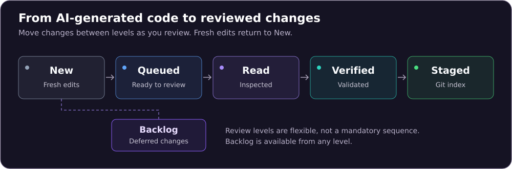

<p align="center">
  
</p>

<h1 align="center">Sonara</h1>

<p align="center"><strong>Your workspace for AI-assisted development.</strong></p>
<p align="center">Capture tasks by voice. Review what your agent changes. Keep your project and your time under control.</p>

<p align="center">
  <a href="https://github.com/shapoval-dev/sonara/releases"></a>
  
  
  
</p>

<p align="center">
  <a href="#quick-start">Quick start</a> · <a href="#features">Features</a> · <a href="#code-review-built-for-ai-agents">Code review</a> · <a href="#documentation">Documentation</a>
</p>

## Why Sonara?

AI agents can write code faster than you can read it. Meanwhile, tasks, notes and review decisions end up scattered across chat windows and tools. Sonara brings them into VS Code, with project data stored as ordinary files rather than in another account or cloud service.

<p align="center">
  
</p>

## Features

| | Capability | What it does for you |
|---|---|---|
|  | **Tasks** | Capture and organize Markdown tasks with priorities, sprints and labels. Copy task context straight into an AI assistant. |
|  | **Code Review** | Review uncommitted Git changes in levels, down to individual hunks. New edits return to New without erasing your earlier review decisions. |
|  | **Code Map** | See file counts, lines of code, sizes and uncommitted changes across your repositories. |
|  | **Voice Dictation** | Speak prompts and notes using local Whisper transcription, with an editable project vocabulary and searchable history. |
|  | **Transcription** | Turn existing audio and video files into searchable Markdown transcripts. |
|  | **Time Tracking** | Track time against your active task and keep daily records as JSON. |
|  | **Media Preview** | Play audio and video inside VS Code, including AAC audio via a temporary FFmpeg conversion. |

## Code review built for AI agents

Git's standard changed/staged workflow does not tell you which edits you have already inspected. Sonara keeps intermediate review levels on top of Git, without requiring a commit for every review decision.

<p align="center"></p>

- Move individual hunks, files, folders or whole levels as you review.
- See the diff for a single level instead of reading every uncommitted change again.
- New edits return to **New**, while previously accepted versions remain on their levels.
- Use **Backlog** for changes you want to defer. **Staged** is the real Git index.
- Review multiple repositories and worktrees; compare image, audio and video changes visually.

Sonara also exposes a **read-only review CLI** for scripts and agents. After opening a repository in VS Code with Sonara active:

```sh
.vscode/sonara/review/sonara-review levels
.vscode/sonara/review/sonara-review list --level new
.vscode/sonara/review/sonara-review diff src/example.ts --level new
```

The CLI reports review state; it does not move levels, stage or commit changes. See the [review guide](https://github.com/shapoval-dev/sonara/blob/HEAD/docs/review.md#read-only-cli).

## Quick start

**Requirements:** VS Code 1.85 or newer. Voice recording runs on Linux with PulseAudio or PipeWire; a CUDA GPU is optional for classic transcription and required for live transcription. The first voice setup downloads a local Whisper model (default large-v3, approximately 3 GB).

1. Download the latest available `.vsix` from [GitHub Releases](https://github.com/shapoval-dev/sonara/releases).
2. In VS Code, open Extensions, select the **...** menu, choose **Install from VSIX...**, and select the file.
3. Open the Sonara sidebar and create a task, or open a Git repository to start reviewing changes.
4. On Linux, press `Ctrl+Shift+M` to start dictating and press it again to stop.

You can also install a downloaded package from the terminal:

```sh
code --install-extension sonara-0.1.0.vsix
```

## Local-first by design

No account. No cloud transcription. No telemetry. Sonara keeps its project data under `.vscode/sonara/`, so you choose what stays local and what travels with the repository.

| Data | Format |
|---|---|
| Tasks and file transcripts | Markdown |
| Voice history | JSONL |
| Time tracking | JSON |
| Review state | Local accepted versions and records |

Voice recording is transcribed locally; the original recording is not retained after dictation. Exclude private voice logs and transcripts from shared repositories if necessary.

## Documentation

| Guide | Contents |
|---|---|
| [Getting started](https://github.com/shapoval-dev/sonara/blob/HEAD/docs/getting-started.md) | Requirements, installation, multi-project workflow, shortcuts and building |
| [Features](https://github.com/shapoval-dev/sonara/blob/HEAD/docs/features.md) | Tasks, Code Map, media preview, voice, transcripts and time tracking |
| [Review](https://github.com/shapoval-dev/sonara/blob/HEAD/docs/review.md) | Review levels, worktrees, diffs, staging, reverting and CLI |
| [Voice](https://github.com/shapoval-dev/sonara/blob/HEAD/docs/voice.md) | Whisper server, GPU/CPU behavior, streaming and vocabulary |
| [Project files](https://github.com/shapoval-dev/sonara/blob/HEAD/docs/project-files.md) | Task format, storage layout, JSON formats and privacy |
| [Configuration](https://github.com/shapoval-dev/sonara/blob/HEAD/docs/configuration.md) | All extension settings |

## License

[MIT](LICENSE). Third-party notices, including Lucide icons, are listed in [NOTICE](NOTICE).
